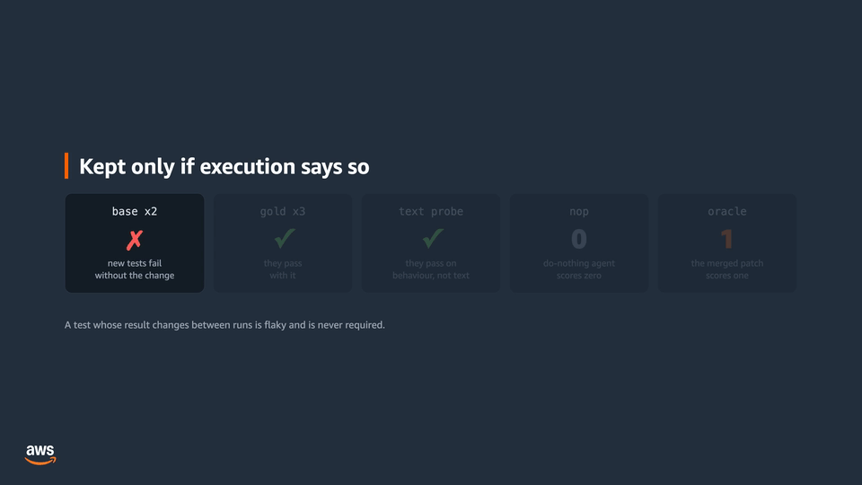

# taskmine

Turn a repository's merged pull requests into a Terminal-Bench / Harbor coding benchmark, where
every task has been proven by execution.

<p align="center">
  <video src="docs/media/taskmine.mp4" poster="docs/media/taskmine-poster.png" controls width="820">
    <a href="docs/media/taskmine.mp4"></a>
  </video>
</p>
<p align="center"><a href="docs/media/taskmine.mp4"><b>Watch the 100-second narrated overview</b></a> (MP4, 1080p, 4 MB)</p>

Dogfooded on 552 merged pull requests of a private TypeScript monorepo: **173 tasks**, each passing
Harbor's own `oracle` (173/173 at 1.0) and failing its `nop` agent (173/173 at 0.0).
See [docs/DOGFOOD.md](docs/DOGFOOD.md).

A task is the repository at the commit just before a merged change, an instruction, and a hidden
test suite. It is kept only when execution shows all of the following, in the image the task
ships with:

- the change's tests **fail** without the change, in every repeated run;
- they **pass** with the change, in every repeated run;
- Harbor's do-nothing agent (`nop`) scores **0** and its `oracle` agent scores **1**.

The output is a directory of standard Harbor task directories (`instruction.md`, `task.toml`,
`environment/`, `solution/`, `tests/`), the format Terminal-Bench 2.x uses. Run it like any
Terminal-Bench dataset and compare harnesses and models on your own code:

```sh
harbor run -p out/tasks -a claude-code -m <model>
harbor run -p out/tasks -a codex -m <model>
```

## Why another tool

[sample-code-eval-harvester](https://github.com/aws-samples/sample-code-eval-harvester) mines pull
request **review** history into approve/deny datapoints for a PR-review agent. It is careful work
(answer-absence sealing, a model-free CLI), and it answers a different question. taskmine answers
"how well does this agent or harness write code in our repository?":

| | eval-harvester | taskmine |
|---|---|---|
| What the agent does | reads a diff, says approve or block | edits the repository until hidden tests pass |
| Which PRs qualify | ones that went through review iterations (a rejected push, comments, an approved push) | any merged PR that adds or changes a runnable test and changes code |
| Who decides the label | a coding agent fills the "defect vs nit" judgment slots of each candidate | execution: fail before, pass after, repeated; no model anywhere |
| How a run is graded | an LLM judge (pinned Claude Haiku 4.5 on Bedrock) matches the agent's findings to the mined ones | the repository's own tests, from the runner's JUnit report |
| Dependencies | none needed (nothing runs) | installed in the image from the repository's own lockfiles, cached across tasks |
| Answer absence | scans the datapoint for its own answer | the snapshot is re-read and every file is proven to be the base commit's; the instruction is checked against the gold patch |
| Reproducibility | | a draft rebuilt from the same inputs has the same sha256, so a dataset validated on one machine is rebuilt byte-for-byte on another |
| Runtime | Lambda MicroVMs, public network only | any Docker host; validation runs with `--network none` |

## Principles

1. **Execution decides.** Fail-to-pass and pass-to-pass tests are read from the test runner's own
   JUnit report, across repeated runs. A test whose result changes between runs is flaky and is in
   neither set. Nothing is labelled by a model.
2. **No sentence in an instruction is written by a model.** The instruction is assembled from
   the pull request title, the issue the pull request closed (quoted, only when it was opened
   before the pull request and passes the leak check), the names of the fail-to-pass tests
   verbatim, and the interface contract. Pull request bodies are never used: they describe the fix.
3. **Hidden tests are fair.** The *interface contract* is computed, not judged: identifiers the
   tests use that occur nowhere in the base repository but that the change adds, modules the tests
   import that the change creates, and string literals the tests check that only the change adds.
   The instruction names them. This is the failure mode behind most of the tasks SWE-bench
   Verified's human review removed (tests that require a name or message the issue never states).
4. **Sealed.** The image holds the base commit's files and a fresh one-commit git repository, no
   history. `verify_seal` re-reads the finished archive and proves every member equals the base
   tree's blob at that path. Hidden tests live in `tests/`, which Harbor copies in only after the
   agent finishes; the grader then restores every test-side file the agent touched.
5. **Every refusal has a reason.** `scan`, `build`, `validate` and `finalize` each write the code
   and a sentence for every unit they leave out; `report` prints the whole funnel.

## How it works

```
taskmine scan      --recipe taskmine.toml --repo CLONE --out out   # change units -> candidates.jsonl
taskmine meta      --recipe taskmine.toml --out out                # optional: PR titles + closing issues (gh)
taskmine build     --recipe taskmine.toml --repo CLONE --out out   # a draft Harbor task per candidate
taskmine validate  --recipe taskmine.toml --out out --jobs 14      # Docker: base x2, gold x3, nop, oracle
taskmine finalize  --recipe taskmine.toml --out out                # instruction.md + task.toml -> out/tasks/
taskmine check     out/tasks                                       # static checks, no Docker needed
taskmine report    --out out                                       # the funnel
```

- A **change unit** is a merge commit (base = first parent) or, for squash-merge histories, a
  first-parent commit. Files split into the **test side** (`[tests] paths`) and the **gold side**.
- A **profile** names one test runner: which test files it runs, the image, the dependency
  manifests and install command, and the command, which must write JUnit XML to `{junit}`. Every
  mainstream runner can: `node --test --test-reporter=junit`, `vitest --reporter=junit`,
  `pytest --junitxml`, `go test` via `gotestsum --junitfile`, `jest` via `jest-junit`.
- The **Dockerfile** copies the dependency manifests and installs them before it adds the
  snapshot, so tasks with the same manifests share the install layer. `deps_normalize = "npm"`
  ignores a release's own version bump when deciding "same manifests".

Requirements: Python 3.11+ (standard library only), git, and Docker for `validate`. Run in place
with `PYTHONPATH=src python3 -m taskmine ...` or install with `uv tool install .`.

## The recipe

One file per repository. See [examples/foxl-pilot/taskmine.toml](examples/foxl-pilot/taskmine.toml)
for a real one (three profiles in a TypeScript monorepo). Unknown keys are an error.

```toml
[repo]
name = "acme/shop"
github = "acme/shop"            # optional: titles and closing issues through `gh`

[units]
kind = "merges"                 # or "commits" for squash-merge histories
branch = "main"
since = "2026-01-01"

[[profiles]]
name = "pytest"
run = ["tests/test_*.py"]
image = "python:3.12-bookworm@sha256:..."
deps = ["requirements.txt"]
install = "pip install -r /app/requirements.txt"
command = "python -m pytest -p no:cacheprovider --junitxml={junit} {files}"
display_command = "python -m pytest {files}"
```

## What a verifier can and cannot rule out

The grader runs in the agent's container (Harbor's shared verifier mode, as in Terminal-Bench).
It writes reward 0 first, restores the test side from the base commit, installs the hidden tests,
and rewards 1 only if every fail-to-pass and pass-to-pass test passes. An agent cannot pass by
editing tests or test helpers. It could still tamper with the runtime itself (the interpreter,
installed packages), which no verifier sharing its container can rule out.

## Status

Verified end to end on `node --test` and `tsx --test`: 552 pull requests in, 173 tasks out, Harbor
0.27.0 oracle 1.0 and nop 0.0 on all 173, Harbor 0.22.0 on a sample of 12, and a byte-identical rebuild
of 10 sampled tasks on a second machine ([docs/DOGFOOD.md](docs/DOGFOOD.md)). Other runners go
through the same JUnit path but have not been run yet. The text probe is Node-only; other runtimes
fall back to a static, file-level check.

## The video

Made with the video-generator plugin's pieces ([docs/media/src/make_video.py](docs/media/src/make_video.py)):
slides in its AWS 2026 dark theme rendered at 2x, narration by Amazon Polly (generative voice
Matthew), cross-fades with ffmpeg. Every number on screen is read from the dataset by
[gen_numbers.py](docs/media/src/gen_numbers.py); no frame is generated imagery. Amazon Nova 2 Lite's
QA scored it 10 visual quality, 10 audio-visual sync, 9 pacing, 10 text readability, 9 cohesion
([qa.json](docs/media/src/qa.json)). The logo is the AWS 2026 template's, as the plugin ships it:
check brand guidance before publishing the video outside Amazon. To regenerate it, see
[docs/media/src/README.md](docs/media/src/README.md).

## Repository layout

| Path | What it is |
|---|---|
| `src/taskmine/cli.py` | the seven verbs and their help |
| `src/taskmine/scan.py` | change units, the test-side / gold-side split, refusal codes |
| `src/taskmine/snapshot.py`, `deps.py` | the sealed base snapshot and the shared dependency layer |
| `src/taskmine/contract.py`, `instruction.py`, `leak.py` | the interface contract, the instruction, the answer-absence check |
| `src/taskmine/emit.py` | drafts, digests, finished Harbor tasks |
| `src/taskmine/validate.py` | the Docker and local executors, fail-to-pass analysis, the text probe |
| `src/taskmine/templates/` | what goes into every task: Dockerfile, `test.sh`, `grader.py`, `solve.sh`; and `textprobe.mjs`, used only while validating |
| `src/taskmine/check.py`, `report.py` | static checks on finished tasks, the funnel report |
| `examples/foxl-pilot/` | the recipe the dogfood run used (three profiles in one monorepo) |
| `docs/DOGFOOD.md` | that run: numbers, findings, the bugs it found |
| `tests/` | unit tests and an end-to-end run over a real git repository |

## Development

```sh
PYTHONPATH=src python3 -m unittest discover -s tests   # 19 tests; the end-to-end ones need git and node
PYTHONPATH=src python3 -m taskmine --help
```

The end-to-end tests create a git repository with real merges and run `scan`, `build`,
`validate` (local executor), `finalize` and `check` over it; nothing is mocked.

License: MIT-0 ([LICENSE](LICENSE)).
